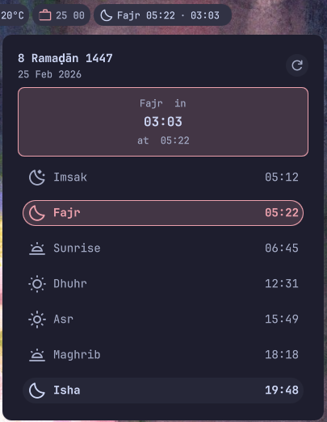

# Prayer Times

A DankMaterialShell widget for displaying Islamic prayer times using the Aladhan API.

## Preview



## Features

- Displays current and next prayer times in the Dank Bar
- Popout view showing all prayer times (Fajr, Dhuhr, Asr, Maghrib, Isha) and dates (Hijri and Gregorian)
- Pure QML/JavaScript — no external tools (`curl`, `jq`, `bash`) required
- API data fetched via `XMLHttpRequest` and cached persistently for 7 days; changing coordinates, calculation method, school, or offsets invalidates the cache
- Configurable refresh interval and location (latitude/longitude)
- Configurable desktop notifications before and at prayer time, with Low, Normal, or Critical priority

## Installation

### From Plugin Registry (Recommended)

```bash
# dms plugins install prayerTimes
# or install using the plugins tab on DMS settings
```

### Manual Installation

```bash
# Copy plugin to DMS plugins directory
cp -r "prayerTimesPlugin" ~/.config/DankMaterialShell/plugins/

# Enable in DMS plugins tab and add the widget to Dank Bar
```

## Configuration

- **Refresh Interval**: Set how often to update prayer times (1-60 minutes, default: 5 minutes)
- **Latitude**: Set your location's latitude (default: -6.2088, Jakarta)
- **Longitude**: Set your location's longitude (default: 106.8456, Jakarta)

- **Enable Notifications**: Enable or disable all plugin notifications, including reminders, prayer-time alerts, and API errors (default: enabled)
- **Notification Priority**: Choose Low, Normal, or Critical for all plugin notifications (default: Critical). Presentation depends on your desktop notification settings.

Location must be entered manually; the plugin does not detect it automatically. The **Auto** calculation method lets the API select a method for the entered coordinates.

Access settings through the DMS plugins settings panel.

## Requirements

- DankMaterialShell >= 0.2.4
- Wayland compositor (Niri, Hyprland, etc.)

> **Note:** No external tools required — API calls and JSON processing are handled entirely in QML/JavaScript.

## Compatibility

- **Compositors**: Niri and Hyprland
- **Distros**: Universal - works on any Linux distribution

## API

This plugin uses the [Aladhan Prayer Times API](https://aladhan.com/prayer-times-api) for accurate prayer time calculations.

## Contributing

Found a bug? Open an issue or submit a pull request!

## Author

Created by muadz

## Links

- [DankMaterialShell](https://github.com/AvengeMedia/DankMaterialShell)
- [Plugin Registry](https://github.com/AvengeMedia/dms-plugin-registry)
- [Aladhan API](https://aladhan.com/prayer-times-api)
